# Compulsory Elective 1 (M 25.6): Data Analysis in High Dimensions
**Vietnamese-German University (VGU)** • Winter Semester 2026–2027  
**Instructor:** Prof. Dr. Christina Andersson • **Credits:** 5 ECTS  
**Group Topic:** Canonical Correlation Analysis (CCA)  
**GitHub Repository:** [KiwisCodes/vgu-data-analysis-cca](https://github.com/KiwisCodes/vgu-data-analysis-cca)

---

## 📌 Project Overview

This repository contains the primary survey data, data cleaning pipeline in **R**, statistical analysis, presentation materials, and the final project report for **Data Analysis in High Dimensions**.

* **Multivariate Method:** **Canonical Correlation Analysis (CCA)** (Lecture Slides 190–232).
* **Research Focus:** Investigating the multivariate relationship between **University Student Lifestyle & Tech Habits (Set X)** and **Academic Performance & Psychological Well-Being (Set Y)**.
* **Empirical Data:** Self-administered survey among university students (**N = 124 valid responses**).
* **Grading Policy:** **No written exam.** The course grade is based on:
  * **Oral Presentation (Nov 16, 2026):** 3 to 5 minutes per member.
  * **Final Written Report (Nov 25, 2026):** 2 to 3 pages per member (one consolidated report with R code appendix).

---

## 📅 Timeline & Milestones

| Date | Milestone | Description & Quotas |
| :--- | :--- | :--- |
| **Nov 4, 2026** | **Topic Registration** | Group registered on Moodle; selected **Canonical Correlation Analysis**. |
| **Nov 16, 2026** | **Oral Presentation** | Presentation at VGU campus (**3 to 5 minutes per person**). |
| **Nov 25, 2026** | **Report Submission** | Consolidated report (**2 to 3 pages per person**, 8–12 pages for 4 members) + R code. |

---

## 🎯 Theoretical Framework: Canonical Correlation Analysis (CCA)

Canonical Correlation Analysis (Chapter 6 of lecture deck, Slides 190–232) investigates the relationship between **two multidimensional sets of variables** measured on the same subjects:
* **Predictor Battery X (p = 7 variables):** Daily lifestyle, digital screen time, study patterns, and AI tool reliance.
* **Outcome Battery Y (q = 5 variables):** Academic GPA, cohort rank, course failures, perceived stress, and self-esteem.

### 1. Mathematical Formulation
Instead of computing $7 \times 5 = 35$ separate pairwise correlations (which inflates Type I error and ignores interdependencies), CCA extracts synthetic linear combinations called **Canonical Variates**:

$$U_1 = a_1 X_1 + a_2 X_2 + \dots + a_p X_p = \mathbf{a}'\mathbf{X}$$

$$V_1 = b_1 Y_1 + b_2 Y_2 + \dots + b_q Y_q = \mathbf{b}'\mathbf{Y}$$

The weight vectors $\mathbf{a}$ and $\mathbf{b}$ are chosen to maximize the Pearson correlation:

$$\rho^*_1 = \mathrm{Corr}(U_1, V_1) = \frac{\mathbf{a}' \mathbf{\Sigma}_{xy} \mathbf{b}}{\sqrt{(\mathbf{a}' \mathbf{\Sigma}_{xx} \mathbf{a})(\mathbf{b}' \mathbf{\Sigma}_{yy} \mathbf{b})}}$$

### 2. Constraints & Orthogonality
To obtain unique mathematical solutions via eigenvalue decomposition:

**Unit Variance Constraint:**  
Each canonical variate is scaled to have a variance of 1:

$$\mathrm{Var}(U_i) = \mathbf{a}_i' \mathbf{\Sigma}_{xx} \mathbf{a}_i = 1 \quad \text{and} \quad \mathrm{Var}(V_i) = \mathbf{b}_i' \mathbf{\Sigma}_{yy} \mathbf{b}_i = 1$$

**Orthogonality Constraint:**  
Subsequent canonical variate pairs $(U_2, V_2), \dots, (U_k, V_k)$ must be completely uncorrelated with all previous pairs:

$$\mathrm{Cov}(U_i, U_j) = 0, \quad \mathrm{Cov}(V_i, V_j) = 0, \quad \mathrm{Cov}(U_i, V_j) = 0 \quad (i \ne j)$$

**Canonical Dimensions:**  
The maximum number of canonical variate pairs extracted is:

$$k = \min(p, q) = \min(7, 5) = 5 \text{ pairs}$$

### 3. Hypothesis Testing (Wilks' Lambda)
We test whether canonical correlations are statistically significant using Wilks' Lambda $\Lambda$ (Slides 222–231):

$$\Lambda_1 = \prod_{i=1}^k (1 - \rho_i^2)$$

* **Test 1 (Full Model Independence):**
  $$H_0: \rho_1 = \rho_2 = \dots = \rho_k = 0$$
  Tests whether Set X and Set Y are completely independent. If $p < 0.05$, at least the first canonical pair is statistically significant.

* **Test 2 (Remaining Dimensions):**
  $$H_0: \rho_2 = \dots = \rho_k = 0$$
  Tests whether the second and subsequent dimensions carry significant correlation after removing the first pair.

---

## 📊 The Finalized Survey Instrument (N = 124)

The survey collected 125 raw responses. One obvious troll submission (`Major = "ăn tàn phá hoại"`, Sleep = 0h, Workout = 8h, Failed = 19) was filtered out, leaving **N = 124 clean, valid responses**.

```mermaid
flowchart LR
    subgraph Set_X ["Set X: Lifestyle & Tech Habits (p = 7)"]
        X1["x_sleep_hours (3–12h)"]
        X2["x_phone_bed (0–8h)"]
        X3["x_sitting_hours (2–16h)"]
        X4["x_workout_hours (0–4h)"]
        X5["x_friends_hangout (0–30)"]
        X6["x_friends_study (0–10)"]
        X7["x_ai_reliance (Scale 1–7)"]
    end

    subgraph CCA_Engine ["Canonical Correlation Engine"]
        U1["U1: Lifestyle Variate"]
        V1["V1: Academic & Well-being Variate"]
    end

    subgraph Set_Y ["Set Y: Academic & Well-being Outcomes (q = 5)"]
        Y1["y_gpa_pct (50–100%)"]
        Y2["y_academic_rank (Scale 1–4)"]
        Y3["y_failed_courses (0–5)"]
        Y4["y_total_stress (PSS-4: 0–16)"]
        Y5["y_self_esteem (Scale 1–7)"]
    end

    Set_X -->|"Weight vector a"| U1
    U1 <-->|"Canonical Correlation Rc1"| V1
    Set_Y -->|"Weight vector b"| V1
```



### Survey Variables & Scales

| Variable Name | Description & Survey Question | Scale / Unit | Transformation in R |
| :--- | :--- | :---: | :--- |
| `x_sleep_hours` | Daily sleep duration | Hours (3–12) | Continuous numeric |
| `x_phone_bed` | Bedtime phone screen time for entertainment | Hours (0–8) | Continuous numeric |
| `x_sitting_hours` | Typical sedentary sitting time | Hours (2–16) | Continuous numeric |
| `x_workout_hours` | Daily exercise and sports time | Hours (0–4) | Continuous numeric |
| `x_friends_hangout` | Friends usually hanging out with | Count (0–30) | Discrete count |
| `x_friends_study` | Friends usually studying with | Count (0–10) | Discrete count (0 = study alone) |
| `x_ai_reliance` | Level of control given to AI in study/work | Ordinal (1–7) | Exact 1:1 text mapping (1 = No AI to 7 = Max AI autonomy) |
| `y_gpa_pct` | Cumulative Academic GPA | Percentage (50–100%) | Normalized across 4-point, 10-point, and German scales |
| `y_academic_rank` | Perceived academic rank in cohort | Ordinal (1–4) | Top 10% = 4, Top 30% = 3, Top 50% = 2, Top 70% = 1, Other = 2.5 |
| `y_failed_courses` | Number of failed courses on first attempt | Count (0–5) | Discrete count |
| `y_total_stress` | Cohen Perceived Stress Scale (PSS-4) | Score (0–16) | Sum of 4 items with items 18 & 19 **reverse-coded** |
| `y_self_esteem` | Single-Item Self-Esteem Scale (SISE) | Rating (1–7) | Likert scale (1 = Not true of me to 7 = Very true) |

---

## 💻 R Preprocessing Implementation (`01_preprocess_data.R`)

The preprocessing script handles all cleaning, exact text matching, scale conversion, and normalization:

```r
# 01_preprocess_data.R - Key Transformations

# 1. Exact string dictionary for AI reliance
ai_reliance_map <- c(
  "I don’t use AI for my work or study." = 1,
  "Less than 5% – I give my idea to the AI and validate its execution" = 1,
  "I do the idea and the work; AI only helps with small things (explaining, grammar, bugs)." = 2,
  "25% – I and the AI work on the idea and execution together" = 3,
  "I do the idea; AI does the work; I check it." = 4,
  "AI and I share the idea; AI does the work; I check it." = 5,
  "AI does the idea and the work; I check the idea and the details." = 6,
  "50% – AI automates everything (from idea to execution), I check its idea and execution" = 6,
  "AI does the idea and the work; I check the idea only." = 7
)
X$x_ai_reliance <- unname(ai_reliance_map[df[[10]]])

# 2. GPA Scale Normalization to 0-100%
scale_type <- df[[11]]
gpa_pct <- rep(NA, nrow(df))
gpa_pct[scale_type == "4-point scale (highest = 4.0)"]         <- (as.numeric(df[[12]][scale_type == "4-point scale (highest = 4.0)"]) / 4) * 100
gpa_pct[scale_type == "10-point scale (highest = 10)"]        <- (as.numeric(df[[13]][scale_type == "10-point scale (highest = 10)"]) / 10) * 100
gpa_pct[scale_type == "German scale (1.0 = best, 4.0 = pass)"] <- (4 - as.numeric(df[[14]][scale_type == "German scale (1.0 = best, 4.0 = pass)"])) / 3 * 50 + 50

# 3. PSS-4 Stress Score (Items 18 and 19 reverse-coded)
stress_map <- c("Never" = 0, "Almost never" = 1, "Sometimes" = 2, "Fairly often" = 3, "Very often" = 4)
total_stress <- unname(stress_map[df[[17]]]) + 
                (4 - unname(stress_map[df[[18]]])) + 
                (4 - unname(stress_map[df[[19]]])) + 
                unname(stress_map[df[[20]]])
```

### Preprocessed Datasets Produced:
1. **`survey_clean_unstandardized.csv`**: Natural units (hours, percentages, raw counts). Used for summary statistics, histograms, and presentation boxplots.
2. **`survey_clean_standardized.csv`**: Standardized z-scores ($\mu = 0, \sigma = 1$). Used directly for `cancor(X, Y)` modeling.

---

## 📈 Canonical Correlation Analysis Pipeline (`02_cca_analysis.R`)

The statistical analysis script strictly follows Prof. Andersson's 5-step framework (Slides 190–232):

```r
# Core modeling in 02_cca_analysis.R
X <- as.matrix(data_std[, 1:7])  # 7 Lifestyle variables
Y <- as.matrix(data_std[, 8:12]) # 5 Academic & Well-being variables

# 1. Canonical decomposition
cca <- cancor(X, Y)

# 2. Sequential Wilks' Lambda tests
# Lambda_m = prod(1 - Rc[m:k]^2) with Bartlett's Chi-square approximation

# 3. Canonical variates & loadings
U <- scale(X %*% cca$xcoef[, 1:5])
V <- scale(Y %*% cca$ycoef[, 1:5])
loadings_X <- cor(X, U)
loadings_Y <- cor(Y, V)
```

### Empirical Results Summary ($N = 124$)

| Dimension | Canonical Correlation ($R_c$) | Eigenvalue | Wilks' $\Lambda$ | $\chi^2$ Stat | $df$ | $p$-value | Interpretation |
| :---: | :---: | :---: | :---: | :---: | :---: | :---: | :--- |
| **1 to 5** | **0.4235** | **0.2186** | **0.6634** | **47.81** | **35** | **0.0730** | Substantial relationship (Marginal/Sig at $\alpha = 0.10$) |
| **2 to 5** | 0.3346 | 0.1260 | 0.8084 | 24.78 | 24 | 0.4177 | Secondary pattern (Residual dimension) |
| **3 to 5** | 0.2709 | 0.0792 | 0.9103 | 10.95 | 15 | 0.7560 | Non-significant |
| **4 to 5** | 0.1267 | 0.0163 | 0.9824 | 2.07 | 8 | 0.9787 | Non-significant |
| **5 to 5** | 0.0401 | 0.0016 | 0.9984 | 0.19 | 3 | 0.9795 | Non-significant |

### Key Empirical Findings (Dimension 1: Collaborative Academic Routine)
* **The Drivers in Set X (Lifestyle Habits):**
  * `x_friends_study` (**+0.6800**): Studying collaboratively in peer groups is the single strongest positive contributor.
  * `x_sitting_hours` (**+0.3375**) & `x_sleep_hours` (**+0.3061**): Sustained desk study time combined with sufficient sleep supports academic performance.
  * `x_phone_bed` (**-0.2493**): Excessive bedtime phone usage negatively associates with academic wellness.
* **The Outcomes in Set Y (Academic & Well-Being):**
  * `y_academic_rank` (**+0.8612**): Exceptional positive alignment with perceived cohort standing.
  * `y_self_esteem` (**+0.5797**) & `y_gpa_pct` (**+0.4254**): Higher self-esteem and stronger grades.
  * `y_failed_courses` (**-0.2663**): Significantly fewer course failures.

---

## 🎨 Generated Presentation & Report Visualizations (`plots/`)

The script automatically renders 4 publication-quality ($300\text{ dpi}$) figures:

1. **`plots/01_correlation_matrix.png`**: Heatmap displaying all bivariate Pearson correlations between Set X and Set Y.
2. **`plots/02_canonical_correlations.png`**: Scree bar plot of canonical correlation coefficients across all 5 dimensions.
3. **`plots/03_canonical_variates_scatter.png`**: Scatter plot of $U_1$ (Lifestyle Routine) vs. $V_1$ (Academic & Well-being) with linear trendline ($R_{c1} = 0.424$).
4. **`plots/04_canonical_loadings_dim1.png`**: Diverging horizontal bar chart illustrating the canonical structure loadings for Dimension 1.

---

## 📂 Repository Structure

```text
.
├── 01_preprocess_data.R                                             # Data cleaning & validation script
├── 02_cca_analysis.R                                                # Canonical Correlation Analysis & plotting script
├── README.md                                                        # Comprehensive project documentation
├── Responses – Student Lifestyle & Academic Performance Survey.xlsx # Raw survey responses (N = 125)
├── survey_clean_unstandardized.csv                                  # Preprocessed data in natural units (N = 124)
├── survey_clean_standardized.csv                                    # Preprocessed standardized data (Z-scores)
├── cca_summary_tables.txt                                           # Exported statistical summary tables
├── plots/                                                           # Exported 300 DPI figures for presentation
│   ├── 01_correlation_matrix.png
│   ├── 02_canonical_correlations.png
│   ├── 03_canonical_variates_scatter.png
│   └── 04_canonical_loadings_dim1.png
└── docs/                                                            # Official course reference materials
    ├── Course Description-3.pdf
    ├── readmefromprofessor.pdf
    └── vorlesung-1.pdf
```

---

## 🚀 How to Run

1. **Clone the repository:**
   ```bash
   git clone https://github.com/KiwisCodes/vgu-data-analysis-cca.git
   cd vgu-data-analysis-cca
   ```
2. **Execute data preprocessing:**
   ```bash
   Rscript 01_preprocess_data.R
   ```
   *Cleans data, removes outliers, and generates standardized matrices ($N = 124$).*
3. **Execute Canonical Correlation Analysis:**
   ```bash
   Rscript 02_cca_analysis.R
   ```
   *Computes canonical correlations, Wilks' Lambda tests, loadings, and saves all plots in `plots/`.*
